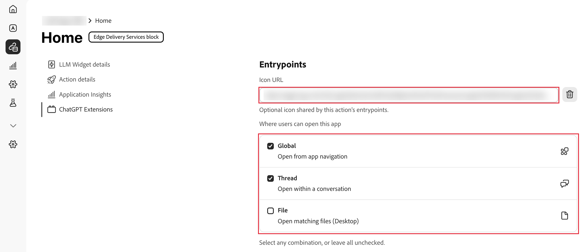

# 設定ChatGPT擴充功能 {#chatgpt-extensions}

>[!IMPORTANT]
>
>所有AEM Sites Cloud Service客戶都可使用LLM應用程式來開發及管理自己的應用程式。 一旦計數開始，每個應用程式呼叫都會計入客戶的AEM Sites內容請求。 Adobe會在計量生效前宣告計量速率和開始日期。

**這些是僅限ChatGPT的擴充功能。** 他們未在[!DNL Claude]或其他LLM平台中設定功能。 您的應用程式仍可透過其標準動作和Widget在這些平台中運作。

使用&#x200B;**[!UICONTROL ChatGPT副檔名]**，讓使用者直接開啟您的應用程式、將其放在交談旁邊、檢視支援的檔案，或在撰寫訊息時尋找專案。

**在本指南中：**&#x200B;瞭解如何設定這些選擇性功能，以及使用者可以如何使用這些功能。 例如，產品目錄；僅啟用應用程式所需的功能。

熒幕擷取畫面中的紅色外框會反白顯示步驟中所使用的控制項。 它們是檔案註解，而不是UI錯誤指標。

## 開始之前 {#before-you-begin}

您需要：

- 現有的LLM應用程式、編輯其動作的許可權，以及工作的工作動作。
- 已發佈的Widget，可直接開啟或檢視檔案。 僅限文字的動作可提供提及搜尋，但無法提供進入點。
- `@adobe/llm-apps-runtime` 1.3.0，而針對Widget功能，`@adobe/llmapps-sdk` 0.2.1或更新版本的支援版本。 請您的應用程式維護者確認兩個版本，並視需要更新提供的Widget指令碼。
- 連線的應用程式以及支援所選擴充功能的使用者端。

>[!IMPORTANT]
>
>可用性因使用者端而異。 檔案進入點是&#x200B;**僅案頭**；撰寫者提及需要&#x200B;**案頭或工作瀏覽器**。 OpenAI的Web支援欄不包括傳統[!DNL ChatGPT]。 請先檢查[平台支援](https://github.com/openai/mcp-extensions/blob/main/docs/spec.md#platform-support)，然後再進行測試。

>[!IMPORTANT]
>
>設定&#x200B;**不**&#x200B;會建置檔案檢視器或實作搜尋。 請您的維護者先準備必要的[動作](/help/guides/customize-handler.md)和[Widget](/help/guides/widgets.md)。

## 開啟ChatGPT擴充功能 {#open-extensions}

1. 開啟應用程式並選取&#x200B;**[!UICONTROL 動作]**。
1. 開啟您要設定的動作。
1. 選取&#x200B;**[!UICONTROL ChatGPT延伸模組]**&#x200B;標籤。

建立動作時也可使用標籤。 本指南使用現有的已稽核動作。

編輯後選取&#x200B;**[!UICONTROL 儲存變更]**。 若要發佈設定，請依照[部署您的應用程式](/help/guides/deploy-your-app.md)和[重新整理ChatGPT連線](/help/guides/test-in-chatgpt.md#refresh-after-app-changes)操作。

## 選擇使用者開啟您的應用程式的位置 {#configure-entrypoints}

**entrypoint**&#x200B;是人們開啟應用程式而不要求模型叫用的地方。

>[!NOTE]
>
>您可以為同一個Widget選取多個入口點。 進入點提供其他開啟方式；它們不會取代正常的聊天引動過程。 當模型可使用動作時，人員仍可在聊天中詢問並接收其Widget。

1. 在&#x200B;**[!UICONTROL 入口點]**&#x200B;下，選擇性地在&#x200B;**[!UICONTROL 圖示URL]**&#x200B;中輸入公用HTTPS影像URL。 此圖示會由此動作的進入點共用；請使用您獲准發佈的影像。
1. 在&#x200B;**[!UICONTROL 使用者可開啟此應用程式]**&#x200B;下方，針對相同的Widget選取下列任一核取方塊組合。 如果動作不需要直接開啟，則保留全部未勾選的狀態。

   | 類型 | 結果 |
   |---|---|
   | **[!UICONTROL 全域]** | 從導覽開啟目錄全熒幕 |
   | **[!UICONTROL 執行緒]** | 開啟目錄，作為交談旁的索引標籤 |
   | **[!UICONTROL 檔案]** | 在自訂檢視器中開啟相符的檔案 |

1. 對於「全域」或「執行緒」，請確認動作無需輸入即可運作。
1. 針對「檔案」，請完成下列設定。

例如，同時選取「全域」和「執行緒」以從導覽或對話旁開啟相同的目錄Widget。 如果Widget支援檔案檢視，您也可以選取「檔案」。 當檔案與全域或執行緒結合時，保留&#x200B;**[!UICONTROL 必要]**&#x200B;為`file`輸入未核取：檔案啟動仍提供檔案物件，但全域和執行緒啟動沒有輸入。 處理常式和Widget必須支援這兩種情況。 僅限檔案的動作可能需要`file`。

**預期結果：**&#x200B;從[全域]的導覽開啟目錄，或作為[執行緒]的交談端索引標籤。

### 從導覽或交談開啟 {#test-global-thread}

下列使用者提供的熒幕擷取畫面說明&#x200B;**首頁**&#x200B;儀表板，而非目錄範例。 導覽和功能表位置可能會因使用者端而異。

針對&#x200B;**全域**，請開啟導覽功能表，然後選取應用程式的進入點。 在此範例中，進入點是&#x200B;**Home**。

![全域ChatGPT視窗，其導覽功能表已開啟，且[首頁]反白顯示為全域進入點](/help/assets/guide-chatgpt-extensions/global-entrypoint-menu.png)

確認控制面板會開啟全熒幕，且導覽邊欄仍然可用。

開啟的Home儀表板

針對&#x200B;**執行緒**，請開啟交談功能表，選取&#x200B;**[!UICONTROL 外掛程式]**，然後選擇進入點。 確認Widget會在對話旁開啟，而不需要新的提示。

### 在您的應用程式中開啟支援的檔案 {#file-entrypoint}

對於已準備的CSV目錄檢視器：

1. 選取「**[!UICONTROL 檔案]**」核取方塊，選取「**[!UICONTROL 新增副檔名]**」，然後輸入`.csv`。 將每個支援的擴充功能新增至其欄位。
1. 在&#x200B;**[!UICONTROL 動作詳細資料]** > **[!UICONTROL 輸入引數]**&#x200B;下，確認名稱為`file`且接受`name`和`resourceUri`的&#x200B;**物件**&#x200B;引數。 如果沒有`file`引數，則選取「檔案」會新增選用的「物件」輸入；請檢查任何現有的定義。 不需要其他輸入。 如果也選取了[全域]或[執行緒]，則保留`file`選項。
1. 在支援的案頭使用者端中，使用您的應用程式開啟非敏感的`.csv`檔案。

**預期結果：**&#x200B;您的Widget會顯示檔案。 儲存編輯內容另外需要實作的編輯支援和可寫入的檔案。

>[!IMPORTANT]
>
>檔案進入點與上傳的檔案引數不同。 他們收到已開啟檔案的資源參考，而不是上傳下載URL或檔案ID。

## 選擇應用程式的顯示方式 {#display-settings}

在&#x200B;**[!UICONTROL 顯示模式]**&#x200B;下：

1. 將模型&#x200B;]**啟動時的**[!UICONTROL &#x200B;顯示設定為`inline`、`fullscreen`或&#x200B;**[!UICONTROL 無喜好設定]**。
1. 選取Widget的&#x200B;**[!UICONTROL 支援的資源顯示模式]**：內嵌、全熒幕或兩者。 保留兩者皆未勾選以使用主機預設值。
1. 選擇&#x200B;**[!UICONTROL 初始資源顯示]**。 如果您選取了支援的模式，則必須包含初始模式。

這些是偏好設定；[!DNL ChatGPT]選擇最終簡報。 全熒幕不會建立側面板標籤：請針對該使用「執行緒」進入點。

檢查Widget是否仍可在您通告的每個模式中使用。

## 讓人們在撰寫器中尋找資源 {#composer-mentions}

撰寫器提及可讓使用者在撰寫訊息時搜尋及選取目錄專案。 使用已傳回可選搜尋結果的動作。

1. 開啟搜尋動作並選取&#x200B;**[!UICONTROL 動作詳細資料]**。
1. 確認名為`query`的&#x200B;**字串**&#x200B;輸入接受空白文字，不含其他必要輸入。
1. 在&#x200B;**[!UICONTROL LLM設定]**&#x200B;下，啟用&#x200B;**[!UICONTROL 唯讀提示]**&#x200B;和&#x200B;**[!UICONTROL 在應用程式介面中顯示為Widget]**。 搜尋動作實際上必須是唯讀的。
1. 在&#x200B;**[!UICONTROL ChatGPT延伸模組]**&#x200B;中，開啟&#x200B;**[!UICONTROL 啟用撰寫者提及]**。
1. 每個應用程式只允許一個提供者。 如果取代舊提供者，請在啟用新提供者之前停用並儲存舊提供者上的提及。

**預期結果：**&#x200B;在應用程式的撰寫器提及搜尋中搜尋已知產品、選取它，並確認訊息中參考了預期的資源。

可見度設定可讓應用程式使用搜尋動作。 提供者不需要自己的視覺化Widget。

下列範例使用&#x200B;**搜尋提及次數**，此純文字動作會搜尋合成檔案而非目錄。 其`query`輸入為&#x200B;**字串**，未勾選&#x200B;**必要**。

在相同動作的&#x200B;**[!UICONTROL ChatGPT延伸模組]**&#x200B;標籤中，**[!UICONTROL 啟用撰寫器提及]**&#x200B;已開啟。

如果已有其他動作提供提及搜尋，則切換功能無法使用，並有警告可識別該動作。 在啟用取代之前，停用現有提供者上的提及並儲存。

## 其他ChatGPT Widget功能 {#additional-widget-features}

SDK也支援ChatGPT專用的深層連結、延伸選取內容、可編輯的草稿以及交談目標定位。 這些需要實施Widget，而非此標籤中的另一個交換器。

| 如果您的介面工具集提供 | 嘗試 |
|---|---|
| 專案的連結 | 開啟連結，並確認目標產品已出現 |
| 選取範圍內容 | 選取不敏感產品並詢問相關問題 |
| 草稿或新交談控制項 | 確認訊息在預期位置開啟，且草稿未自動提交 |

基本Widget訊息和其他標準SDK API並非ChatGPT專用。 請詢問您的維護者您的Widget實作哪些擴充功能；請參閱[SDK檔案](https://www.npmjs.com/package/@adobe/llmapps-sdk)。

## 變更或移除擴充功能 {#change-or-remove}

在同一標籤中，清除進入點的核取方塊或關閉&#x200B;**[!UICONTROL 啟用撰寫器提及]**。 如果沒有剩餘的副檔名，則清除檔案。 若要移除共用圖示，請選取&#x200B;**[!UICONTROL 清除圖示]**。 若要還原顯示預設值，請選取&#x200B;**[!UICONTROL 無喜好設定]**，清除支援的模式，然後選取&#x200B;**[!UICONTROL 主機預設值]**。

移除進入點並不會刪除動作或使用者檔案。 請參閱[欄位定義和規則](/help/reference/reference-docs.md#chatgpt-extension-fields)。

## 疑難排解 {#troubleshooting}

| 您所看到的內容 | 該做什麼 |
|---|---|
| 遺失一個或多個控制項 | 檢查[使用者端支援](#before-you-begin)。 若為進入點，請確認已設定Widget。 這些擴充功能不適用於Claude或其他主機 |
| 將報表儲存為不相容的必要輸入 | 全域/執行緒供給沒有輸入、檔案供給`file`及提及供給`query`。 要求維護者解決不符問題；請勿移除動作所需的輸入 |
| 檔案設定或檢視失敗 | 新增支援的延伸，確認物件`file`輸入，並使用相容的案頭使用者端。 Widget必須實作該檔案格式 |
| 檔案儲存失敗 | 確認編輯支援和寫入許可權。 調解衝突而非覆寫較新的內容；減少過大的內容 |
| 圖示URL無法儲存 | 輸入有效的影像URL或資料URI，或清除選用的圖示。 偏好公開HTTPS影像URL |
| 顯示設定被拒絕或略過 | 在支援的模式中包含初始模式。 ChatGPT控制最終簡報 |
| 提及內容無法啟用 | 檢查唯讀行為、應用程式可見度和`query`輸入。 在啟用舊提供者的取代之前，先儲存移除舊提供者的作業 |
| 搜尋未傳回任何專案或錯誤 | 嘗試已知專案。 空白結果可能有效；向搜尋維護者報告缺少已知專案或錯誤 |
| 無法載入動作 | 提供時使用&#x200B;**[!UICONTROL 重新嘗試載入應用程式動作]**&#x200B;或&#x200B;**[!UICONTROL 重新整理應用程式動作]** |
| 草稿建立失敗 | 檢查使用者端支援。 不要自動傳送原本作為草稿的訊息 |
| 缺少已儲存的變更 | 部署到已測試的環境、重新整理連線，並確認已發佈Widget變更 |
| 儲存不支援的設定進入點區塊 | 選取支援的「全域」、「螺紋」或「檔案」核取方塊，或保留所有核取方塊 |

如需支援，請記錄應用程式、環境、使用者端、失敗步驟和可見錯誤。 請勿包含權杖、私人URL或敏感資料。

## 後續步驟 {#whats-next}

- [部署您的應用程式](/help/guides/deploy-your-app.md)
- [將您的LLM應用程式測試為ChatGPT外掛程式](/help/guides/test-in-chatgpt.md)
- [自訂產生的Widget](/help/guides/widgets.md)
