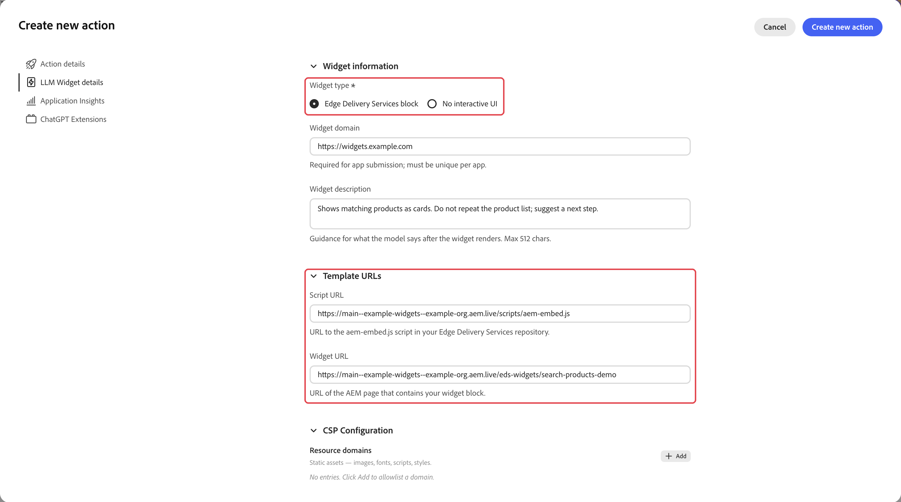

# 從頭開始建立動作 {#create-action-from-scratch}

>[!IMPORTANT]
>
>所有AEM Sites Cloud Service客戶都可使用LLM應用程式來開發及管理自己的應用程式。 一旦計數開始，每個應用程式呼叫都會計入客戶的AEM Sites內容請求。 Adobe會在計量生效前宣告計量速率和開始日期。

>[!NOTE]
>
>本指南假設您已基本熟悉Adobe Edge Delivery Services (EDS)。 如果您是EDS的新手，請先閱讀[EDS開發人員教學課程](https://www.aem.live/developer/tutorial)和[探索區塊](https://www.aem.live/docs/exploring-blocks)以瞭解基本知識（區塊、`decorate`函式和EDS專案結構），然後再連線Widget。

新增平台未建立的功能。 在[!DNL LLM Apps]中定義動作、在連結的存放庫中寫入其處理常式，並視需要新增Widget。

**在本指南中：**&#x200B;瞭解如何定義動作、實作其處理常式，以及連線選用的Widget。 在本機測試動作、部署應用程式，然後在支援的LLM平台中嘗試該動作。

針對您的第一個應用程式，從[基礎結構設定](/help/guides/create-app.md)開始，然後[建立動作](/help/guides/creating-actions.md)。 「建立動作」指南說明從網站自動產生和手動建立。

## 開始之前

您需要：

- 現有的LLM應用程式。
- 連結的處理常式存放庫。
- 存放庫的本機複製及其相依性已安裝。
- EDS專案（如果動作顯示Widget）。
- 生產結果的清除API或資料來源。

## 計畫動作

圍繞一個清除的使用者任務設計每個動作。 在開啟UI之前，請定義：

- **意圖** — 使用者嘗試達到的目的。
- **描述** — 何時選取動作。
- **輸入** — 使用者需要的最少資訊。
- **結果** — 處理常式傳回的文字和結構化資料。
- **行為** — 動作會讀取資料、變更資料或呼叫外部系統。
- **Widget** — 結果是否需要視覺介面。

例如，將此計畫用於&#x200B;**搜尋產品**&#x200B;動作：

```text
Intent: Find products matching a category or search phrase
Inputs:
  category: optional string
  query: optional string
Result:
  content: text summary
  structuredContent: products and total count
Behavior: read-only, idempotent, open-world
Widget: product cards
```

將相關但不同的工作分開。 針對產品搜尋和產品購買使用個別動作，因為這些工作具有不同的輸入、風險和確認需求。

## 建立動作中繼資料

開啟應用程式並選取&#x200B;**[!UICONTROL 動作]**，然後選取&#x200B;**[!UICONTROL 建立動作]**。

**[!UICONTROL 建立新動作]**&#x200B;對話方塊有四個標籤： **[!UICONTROL 動作詳細資料]**、**[!UICONTROL LLM Widget詳細資料]**、**[!UICONTROL 應用程式深入分析]**&#x200B;以及&#x200B;**[!UICONTROL ChatGPT擴充功能]**。 對話方塊會在&#x200B;**[!UICONTROL 動作詳細資料]**&#x200B;開啟。 儲存的動作編輯器會使用相同的標籤。

選用的&#x200B;**[!UICONTROL ChatGPT擴充功能]**&#x200B;設定可讓使用者直接開啟應用程式、使用自訂檔案檢視器，或在支援使用者端的撰寫器中尋找資源。 在對應動作和Widget行為準備就緒後設定這些專案。 請參閱[設定ChatGPT擴充功能](/help/guides/chatgpt-extensions.md)。

### 輸入動作資訊和輸入引數


在&#x200B;**[!UICONTROL 動作資訊]**&#x200B;下，輸入：

- **[!UICONTROL 動作名稱]** — 簡短的工作名稱，例如&#x200B;*搜尋產品*。
- **[!UICONTROL 描述]** — 說明何時使用動作及其傳回的內容。

對話方塊會從名稱（例如`search-products`）衍生&#x200B;**[!UICONTROL 代碼識別碼]**。 識別碼會在建立後修正，且必須在應用程式內是唯一的。 使用處理常式資料夾的確切識別碼。

有用的說明很具體：

```text
Search the product catalog by category or keyword. Returns matching
products with their names, prices, categories, and image URLs.
```

避免模糊的描述，例如&#x200B;*取得產品資訊*。 LLM平台會使用說明來選擇動作。

在&#x200B;**[!UICONTROL 輸入引數]**&#x200B;下，為處理常式接受的每個值選取&#x200B;**[!UICONTROL 新增引數]**&#x200B;一次。 針對每個引數，輸入：

- **[!UICONTROL 引數名稱]** — 處理常式收到的金鑰。
- **[!UICONTROL 型別]** — 字串、數字、整數、布林值、物件或檔案。
- **[!UICONTROL 必要]** — 動作是否需要值。
- **[!UICONTROL 描述]** — 如何擷取值。

針對&#x200B;**搜尋產品**：

```text
category
  Type: String
  Required: No
  Description: Product category used to narrow the catalog.

query
  Type: String
  Required: No
  Description: Product name or search phrase.
```

使用穩定的引數名稱。 變更名稱也需要變更處理常式及其測試。

### 設定LLM設定

展開&#x200B;**[!UICONTROL LLM設定]**。 依預設，該區段會摺疊。


在&#x200B;**[!UICONTROL 註解]**&#x200B;下，只選取動作為True的提示：

- **[!UICONTROL 破壞性提示]** — 動作可以刪除或永久變更資料。
- **[!UICONTROL 等冪（相同的引數=沒有額外的效果）]** — 重複相同的要求會有相同的效果。
- **[!UICONTROL 開放世界提示]** — 動作與外部系統通訊。
- **[!UICONTROL 唯讀提示]** — 動作不會變更資料。

例如，產品搜尋通常是唯讀、等冪和開放世界。

在&#x200B;**[!UICONTROL OpenAI中繼資料]**&#x200B;底下，輸入動作執行時和完成時顯示的簡短訊息，每個訊息最多64個字元：

```text
Invoking status text: Searching products...
Invoked status text: Products found
```

在&#x200B;**[!UICONTROL 可見度]**&#x200B;下：

- **[!UICONTROL 公開給AI模型]**&#x200B;可讓模型選取動作。
- **[!UICONTROL 在應用程式表面顯示為Widget]**&#x200B;會顯示設定的Widget。

可見度不會選擇Widget型別。 若是純文字動作，請選取&#x200B;**[!UICONTROL LLM Widget詳細資料]** > **[!UICONTROL Widget型別]**&#x200B;下的&#x200B;**[!UICONTROL 無互動式UI]**。

### 設定應用程式分析 {#configure-analytics}

開啟&#x200B;**[!UICONTROL Application Insights]**。 **[!UICONTROL 依預設會選取「收集使用者意圖」]**：LLM平台會建立簡短、匿名化的摘要，說明使用者在執行動作時嘗試完成的內容。

如果您設定自己的[!DNL Adobe Analytics]或[!DNL Customer Journey Analytics]，使用者意向也會傳送至該處。 請參閱[設定Adobe Analytics和Customer Journey Analytics](/help/guides/analytics-setup.md)。

請檢閱核取方塊下方的指示，該指示可指導摘要。 將其限製為非敏感、匿名的目的，並在您的隱私權政策中說明您的資料收集。 指示最多可接受2,000個字元。 清除&#x200B;**[!UICONTROL 收集使用者意圖]**&#x200B;以不收集摘要。


如需完整的欄位定義，請參閱[動作和Widget欄位](/help/reference/reference-docs.md)。

## 設定Widget

開啟&#x200B;**[!UICONTROL LLM Widget詳細資料]**。 若是純文字動作，請選取&#x200B;**[!UICONTROL Widget型別]**&#x200B;下的&#x200B;**[!UICONTROL 無互動式UI]**，並略過其餘的Widget設定。



在&#x200B;**[!UICONTROL Widget資訊]**&#x200B;下，設定：

- **[!UICONTROL Widget型別]** — 為互動式Widget選取&#x200B;**[!UICONTROL Edge Delivery Services區塊]**。
- **[!UICONTROL Widget網域]** — Widget的沙箱來源。 UI會根據應用程式提交和每個應用程式的唯一性來識別它；它與EDS頁面URL不同。
- **[!UICONTROL Widget說明]** — 在Widget呈現後，模型所顯示的內容，最多512個字元。

Widget說明與動作說明不同：

- **動作描述**&#x200B;可協助模型決定何時叫用動作。
- **Widget描述**&#x200B;對應至`_meta["openai/widgetDescription"]`並摘要呈現的元件所顯示的內容，減少重複的旁白。

[!DNL LLM Apps]將Widget說明套用為元件中繼資料。 請勿從處理常式傳回說明。

展開&#x200B;**[!UICONTROL 範本URL]**&#x200B;並輸入：

- **[!UICONTROL 指令碼URL]** — EDS Widget進入點。
- **[!UICONTROL Widget URL]** — 此動作的已發佈EDS頁面。

典型的URL為：

```text
Script URL:
https://main--<repo>--<owner>.aem.live/scripts/aem-embed.js

Widget URL:
https://main--<repo>--<owner>.aem.live/<widget-page>
```

在&#x200B;**[!UICONTROL CSP設定]**&#x200B;底下，僅新增資產和網路要求Widget需要的來源。 如果CSP不完整，載入外部資源的Widget可能不會呈現。


如果EDS專案或Widget頁面尚不存在，請完成[自攜EDS專案](/help/guides/bring-your-own-eds.md)，然後返回動作。

## 儲存動作

選取&#x200B;**[!UICONTROL 建立新動作]**。 此動作會顯示在具有&#x200B;**未部署**&#x200B;徽章的「動作」頁面上。

儲存會建立中繼資料，但動作仍需要處理常式。

當您重新開啟儲存的動作時，編輯器會顯示相同的標籤。 若要儲存稍後的編輯，請選取&#x200B;**[!UICONTROL 儲存變更]**。

## 實作處理常式

複製連結的處理常式存放庫並安裝其相依性：

```bash
npm install
```

建立：

```text
actions/
└── search-products/
    └── index.js
```

資料夾名稱必須符合動作編輯器中顯示的動作代碼識別碼。

如需完整的結果合約與處理常式 — Widget關係，請參閱[自訂產生的處理常式](/help/guides/customize-handler.md)。

### 處理常式合約

匯出非同步函式：

```javascript
module.exports = async (args) => {
  return {
    content: [
      { type: 'text', text: 'Response for the LLM platform.' }
    ],
    structuredContent: {
      // Data for the widget.
    }
  };
};
```

處理常式會接收UI中定義的引數。

### 傳回`content`

LLM平台讀取`content`做為文字遞補：

```javascript
content: [
  { type: 'text', text: 'Found 3 matching products.' }
]
```

一律傳回有用的`content`，即使動作具有Widget亦然。

### 傳回`structuredContent`

Widget會將`structuredContent`視為純物件：

```javascript
structuredContent: {
  products: [
    { id: 'P-100', name: 'Product A', price: '$20' }
  ],
  total: 1
}
```

形狀必須符合EDS區塊從`bridge.toolResult`讀取的內容。

### 連線API

將API呼叫保留在伺服器端處理常式。 此範例會呼叫公用產品API。 在名為`PRODUCT_API_ORIGIN`的[應用程式變數](/help/guides/app-variables.md)中設定API的HTTPS來源。 此範例接受以上定義的`query`和`category`引數、至少需要一個引數，而且不需要認證。

```javascript
const { getVariable } = require('@adobe/llm-apps-runtime');

module.exports = async ({ query = '', category = '' } = {}, extra) => {
  const normalizedQuery = typeof query === 'string' ? query.trim() : '';
  const normalizedCategory = typeof category === 'string' ? category.trim() : '';
  if (typeof query !== 'string' || typeof category !== 'string'
      || (!normalizedQuery && !normalizedCategory)
      || normalizedQuery.length > 200 || normalizedCategory.length > 100) {
    return {
      isError: true,
      content: [{ type: 'text', text: 'Enter a valid product search.' }],
      structuredContent: { products: [], total: 0 }
    };
  }

  const apiOrigin = getVariable(extra, 'PRODUCT_API_ORIGIN');
  if (!apiOrigin) {
    throw new Error('Product API configuration is unavailable.');
  }

  const origin = new URL(apiOrigin);
  if (origin.protocol !== 'https:') {
    throw new Error('Product API configuration must use HTTPS.');
  }

  const url = new URL('/v1/products', origin);
  if (normalizedQuery) {
    url.searchParams.set('query', normalizedQuery);
  }
  if (normalizedCategory) {
    url.searchParams.set('category', normalizedCategory);
  }

  const response = await fetch(url, {
    signal: AbortSignal.timeout(8000)
  });

  if (!response.ok) {
    throw new Error('Product service request failed.');
  }

  const payload = await response.json();
  if (!payload || !Array.isArray(payload.products)
      || !payload.products.every((product) =>
        product
        && typeof product.id === 'string'
        && typeof product.name === 'string'
        && typeof product.price === 'string')) {
    throw new Error('Product service returned an unexpected response.');
  }

  const products = payload.products.map((product) => ({
    id: product.id,
    name: product.name,
    price: product.price
  }));

  return {
    content: [
      { type: 'text', text: `Found ${products.length} matching products.` }
    ],
    structuredContent: {
      products,
      total: products.length
    }
  };
};
```

請勿將API認證放入原始程式碼、動作中繼資料、Widget JavaScript、記錄檔或面對使用者的錯誤中。 **[!UICONTROL 變數和密碼]** UI目前僅支援不敏感的變數，不支援密碼。 請勿將API權杖儲存在變數中。 如果您的上游API需要認證，請先安排核准的伺服器端認證機制，然後再進行連線。

對於生產程式碼，在將核准的欄位對應到`structuredContent`之前，請先驗證完整的上游回應。

## 新增處理常式測試

建立比對測試：

```text
test/
└── actions/
    └── search-products.test.js
```

至少測試：

- 有效的輸入。
- 輸入遺失或無效。
- 空白的結果。
- API逾時或失敗。
- API資料格式錯誤。
- Widget預期的`structuredContent`形狀。

執行：

```bash
npm test
```

如需專案配置與本機MCP測試，請參閱[本機處理常式開發與測試](/help/reference/development.md)。

## 在本機測試動作

執行：

```bash
npm run dev:local
```

如果沒有本機`actions.json`，伺服器會以最少的中繼資料發現處理常式，而且沒有輸入結構描述驗證。

使用MCP檢查工具或`curl`來：

1. 列出已註冊的動作。
2. 使用代表性引數呼叫新動作。
3. 驗證`content`和`structuredContent`。
4. 測試無效和空白的請求。

## 連線和測試Widget

如果動作有Widget：

1. 讓Widget讀取處理常式的`structuredContent`。
2. 使用安全DOM API （例如`textContent`）轉譯外部值。
3. 新增載入、空白和錯誤狀態。
4. 在本機預覽EDS頁面。
5. 驗證CSP、CORS和Widget URL。

參閱[自備EDS專案](/help/guides/bring-your-own-eds.md)。

## 部署和測試

1. 認可並推送處理常式和Widget變更。
2. [將應用程式](/help/guides/deploy-your-app.md)部署到Stage。
3. 在[ChatGPT](/help/guides/test-in-chatgpt.md)或[Claude](/help/guides/test-in-claude.md)中測試應用程式。
4. 使用符合動作的提示和不呼叫動作的無關提示來驗證動作選擇。
5. 中繼成功後，請部署至生產環境。

如果中繼資料不存在相符的處理常式，部署會使用預設的Stub註冊動作。 在讓使用者能夠使用動作之前，請新增處理常式。
