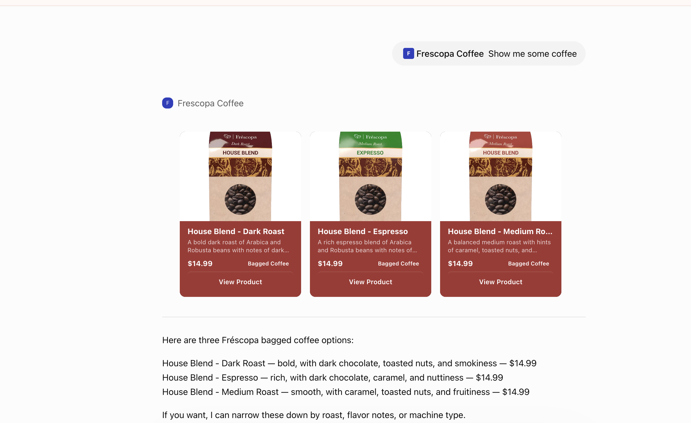

# 將您的LLM App測試為[!DNL ChatGPT]外掛程式 {#test-in-chatgpt}

>[!IMPORTANT]
>
>所有AEM Sites Cloud Service客戶都可使用LLM應用程式來開發及管理自己的應用程式。 一旦計數開始，每個應用程式呼叫都會計入客戶的AEM Sites內容請求。 Adobe會在計量生效前宣告計量速率和開始日期。

部署後，您的LLM應用程式會公開MCP伺服器URL。 將此URL新增至[!DNL ChatGPT]作為外掛程式，然後測試產生的動作和Widget。

**在本指南中：**&#x200B;瞭解如何將部署的應用程式連線到[!DNL ChatGPT]，並在交談中測試其動作和Widget。 變更應用程式後重新整理連線。

## 計畫需求

使用允許新增自訂MCP伺服器的帳戶和工作區。 使用狀態和管理員控制項會因帳戶和工作區而異。 請參閱OpenAI目前的[連線並測試您的外掛程式](https://developers.openai.com/plugins/deploy/connect-chatgpt)檔案。

## 檢查自訂MCP伺服器的存取權

開啟[ChatGPT外掛程式](https://chatgpt.com/plugins)，並檢查您的帳戶是否允許新增自訂MCP伺服器。 如果您的帳戶需要開發人員模式，請使用帳戶的控制項啟用該模式。 如果自訂MCP伺服器選項遺失或遭到封鎖，請詢問您的工作區管理員。

## 複製MCP伺服器URL

在[!DNL LLM Apps]：

1. 開啟「應用程式詳細資料」頁面。
2. 尋找&#x200B;**[!UICONTROL 測試應用程式]**。
3. 在&#x200B;**[!UICONTROL 中繼環境]**&#x200B;下，選取&#x200B;**[!UICONTROL 複製URL]**。

## 建立外掛程式

1. 開啟[chatgpt.com/plugins](https://chatgpt.com/plugins)。
2. 選取&#x200B;**+**，然後選取&#x200B;**[!UICONTROL 新增自訂MCP伺服器]**。
3. 設定連線：
   - **[!UICONTROL 名稱]** — 外掛程式名稱。
   - **[!UICONTROL 描述]** — 選擇性。
   - 選擇公用伺服器連線方法，並輸入應用程式的完整HTTPS MCP伺服器URL。
   - 選擇符合您應用程式的驗證方法。 對於已停用驗證的公用應用程式，使用提供的&#x200B;**[!UICONTROL 無驗證]**。

   >[!NOTE]
   >
   >如果您已開啟一般使用者驗證，請在每個動作設為&#x200B;**[!UICONTROL 必要]**&#x200B;時，選取&#x200B;**[!UICONTROL OAuth]**，或針對提供這些選項的公開與受保護動作組合，選取&#x200B;**[!UICONTROL 混合]**。 請參閱[使用您自己的身分提供者來驗證一般使用者](/help/guides/authentication.md)。

4. 選取&#x200B;**[!UICONTROL 我瞭解並想要繼續]**。
5. 選取&#x200B;**[!UICONTROL 建立為外掛程式]**。
6. 檢閱發現的工具和中繼資料，然後安裝或連線產生的外掛程式。 如果您的應用程式需要，請完成登入。

OpenAI擁有設定UI，其配置可能會因帳戶而異。 如果顯示的標籤不同，請遵循目前的[連線指示](https://developers.openai.com/plugins/deploy/connect-chatgpt)。

## 測試外掛程式

1. 開始新的聊天。
2. 在提示方塊中輸入`@`並選取已安裝的外掛程式。
3. 提出符合其中一個產生之動作的問題。 例如： *給我看點咖啡。*

確認：

- [!DNL ChatGPT]會叫用預期的動作。
- Widget會顯示預期的範例資料。
- 文字回應符合Widget。
- Widget控制項如預期般運作。

此外，測試無效的輸入、空白結果、不相關的不呼叫應用程式的提示，以及變更資料的動作。 檢閱每個確認和驗證提示，而不是事先核准所有請求。

### 測試選擇性擴充功能

如果您已設定[ChatGPT擴充功能](/help/guides/chatgpt-extensions.md)，請嘗試每個選取的進入點、顯示設定和撰寫器搜尋，並將結果與該指南中的預期行為進行比較。 如果有多個入口點使用相同的Widget，請測試每個選取的開啟方式，包括沒有「全域」或「螺紋」的檔案。 連線應用程式或叫用對話中的動作無法驗證這些功能。 請先檢查[使用者端需求](/help/guides/chatgpt-extensions.md#before-you-begin)：檔案輸入點需要案頭，而OpenAI的擴充功能網頁支援不包括傳統ChatGPT。

## 應用程式變更後重新整理

變更動作說明、輸入、驗證或Widget設定後：

1. 將更新的應用程式部署到相同環境。
2. 在[ChatGPT外掛程式](https://chatgpt.com/plugins)上開啟其連線，並選取&#x200B;**[!UICONTROL 重新整理]**。
3. 確認已變更通告的動作。
4. 開始新交談並重複受影響的測試。

## 後續步驟

- [自訂產生的Widget](/help/guides/widgets.md)。
- [從頭開始建立動作](/help/guides/create-action.md)。
